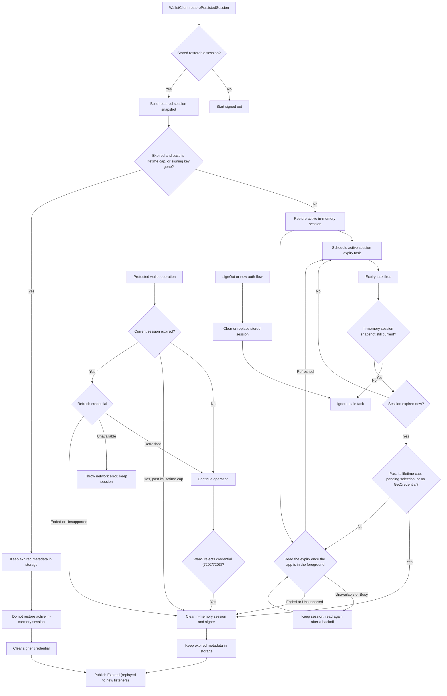

# Session Expiry Flow

This note documents the wallet session expiry flow for maintainers. Public API
behavior is covered in `docs/api.md`; this file focuses on how restored, active,
and stale expiry paths are coordinated.

## Behavior Contract

- `OMSWalletSession.expiresAt` (and `WalletCredential.expiresAt`) is the current
  expiry: WaaS slides it forward with use up to the requested lifetime (at most
  180 days), and the SDK refreshes it with WaaS `GetCredential`.
- A valid stored session is restored into memory, gets an expiry task, and is
  refreshed in the background. Restore itself never waits for or fails on the
  refresh.
- A stored session whose expiry has passed may still be active on WaaS:
  requests after the last read can have moved the server expiry. Unless its
  lifetime cap has passed, it is restored as active and the restore read
  decides. Past the cap, or without its signing key (an earlier launch already
  ended it), it is not restored as active, but its metadata stays in storage so
  its `Expired` change replays to listeners after process recreation.
- A session active in memory can expire from the scheduled task or from a
  protected wallet operation checking the session before use. Past the lifetime
  cap, both end it without a request; otherwise both read the expiry from WaaS
  first: an extended expiry keeps the session, and only a session WaaS reports
  ended (or a WaaS without `GetCredential`) expires.
- WaaS ends a session about 10 days after its last use, and never after its
  lifetime cap `N`. Every request signed with the session's credential,
  `GetCredential` included, moves the expiry toward 10 days after it, capped at
  `N`. The read at the local expiry therefore extends a live session, which is
  intended: the app is in use when it runs, and the read becomes the session's
  last use, so the next read after the new expiry finds the session ended unless
  something else used it. With an accurate device clock (the expiry is WaaS time
  compared with device time) and an app running in the foreground, an ended
  session is noticed at its expiry; the task cannot fire while the app is
  suspended or not running.
- Sign-in records the session's lifetime cap `N` from `CompleteAuth`: with
  `C0` the request's send time, `L0` the returned expiry, and `R` the requested
  lifetime, `N = max(C0 + R, L0)` (unknown when `L0` does not parse or is not
  after `C0`). It is kept with the session and saved in the session store record
  as `expiryCeilingEpochMillis`. A stored record without a valid cap (saved by an
  earlier 0.4.0 build, or for a session whose cap was unknown) is discarded on
  restore like any invalid record, and the user signs in again; an
  `idleWindowMillis` field from 0.4.0 pre-releases is ignored.
- A request signed with the session's credential that WaaS rejects with 7202
  `KeyNotFound` or 7203 `KeyExpired`, or a `GetCredential` that WaaS answers with
  7207 `Unauthorized` (the credential was revoked), ends the session like local
  expiry and fails with `OMS_SESSION_EXPIRED`. 7207 from any other call stays a
  request error. Unsigned `WaasPublic` calls never end the session.
- `signOut()` or a new auth flow clears or replaces stored session metadata,
  which cancels stale expired-session replay.

## Credential Refresh

`refreshSessionCredential` in `WalletClient` is the only refresh primitive.
Concurrent callers for the same session share one in-flight request, and a
result is applied only while the session revision that started it is current
(expiry updates do not bump the revision, so in-flight operations keep their
ownership). Outcomes:

| Outcome | Cause | Effect |
|---|---|---|
| Refreshed | `GetCredential` succeeded with a parseable `expiresAt` | The expiry replaces the session expiry (later or earlier), is saved to the session store, and reschedules the expiry task; its completion time becomes the last expiry read |
| Ended | 7202 or 7203 (the transport ends the session), or 7207 (the refresh ends it) | The session ended and listeners were notified |
| Unsupported | `WebrpcBadRoute` (WaaS without `GetCredential`) | Refreshes are skipped and local expiry stays exact for 15 minutes; then the next trigger probes `GetCredential` again, and an answer clears it while another `WebrpcBadRoute` restarts the 15 minutes |
| Unavailable | Network or any other error, or an `expiresAt` that does not parse | Session unchanged |
| Busy | A signed session request was in flight when a background refresh tried to start, or the caller that started the shared refresh was cancelled | Skipped until the next trigger; a caller that needs an answer (a protected operation) starts a new refresh |

Triggers:

- Session read (`readSessionExpiryInForeground`), after a restore and from the
  expiry task: reads the expiry once the app has a started activity (the
  process lifecycle, `ProcessLifecycleOwner`), because the read extends the
  session: a process started in the background (a push message, a broadcast, a
  scheduled job, or boot) runs it once an activity starts, and skips it if the
  session changed meanwhile or another read succeeded since it was requested.
  Only one read is pending at a time; the expiry task joins one already waiting.
  Refreshed keeps the session; Ended expires it; Unsupported makes a locally
  expired session expire; Unavailable or Busy keep the session and retry the
  read after 60 seconds, doubling up to 15 minutes, each time once the app is in
  the foreground. A restore leaves the 6-hour refresh clock unset, and so does a
  read that is Busy or Unavailable, so until a read reaches WaaS the next
  successful signed call refreshes.
- Expiry task at the local expiry `L`: a session past its lifetime cap, a
  pending manual wallet selection, or a session on a WaaS known to lack
  `GetCredential` expires without a request; any other session starts the
  session read.
- Protected operation on a locally expired session: past the lifetime cap,
  throws `OMS_SESSION_EXPIRED` without a request; otherwise awaits the refresh.
  Refreshed continues the operation; Ended or Unsupported throw
  `OMS_SESSION_EXPIRED`; Unavailable throws the network error and keeps the
  session.
- After a successful signed call (not `GetCredential`): background refresh when
  the last `GetCredential` sent or sign-in was at least 6 hours ago, or no
  `GetCredential` has reached WaaS since a restore. A refresh skipped as Busy
  sends nothing, so it does not restart the 6 hours and the next successful
  signed call tries again.
- A signed call other than `GetCredential` answered with 7207 `Unauthorized`:
  background refresh (shared with one already in flight), because 7207 can mean
  a revoked credential or only a wallet access error. A 7207 answer to the
  refresh ends the session; otherwise the call stays a request error and the
  session continues.

WaaS requires strictly increasing nonces per credential, so every request
signed with one credential, refreshes included, takes one turn at a time, first
come first served, across every client of the scope in the process; requests
signed with another credential (a new sign-in's key) do not wait for them. A
background refresh starts only when the credential's queue is empty and is
skipped otherwise; an awaited refresh waits for its turn within its 30-second
deadline. Requests from another process, device, or SDK version with the same
credential are not ordered with these, so one can still reach WaaS after a
request with a later nonce; WaaS then rejects it in its credential middleware,
before running the method, with 7206 `PreconditionFailed` (HTTP 412), and the
signed transport signs it again with a fresh nonce and resends it, at most 2
times.

## Flow

