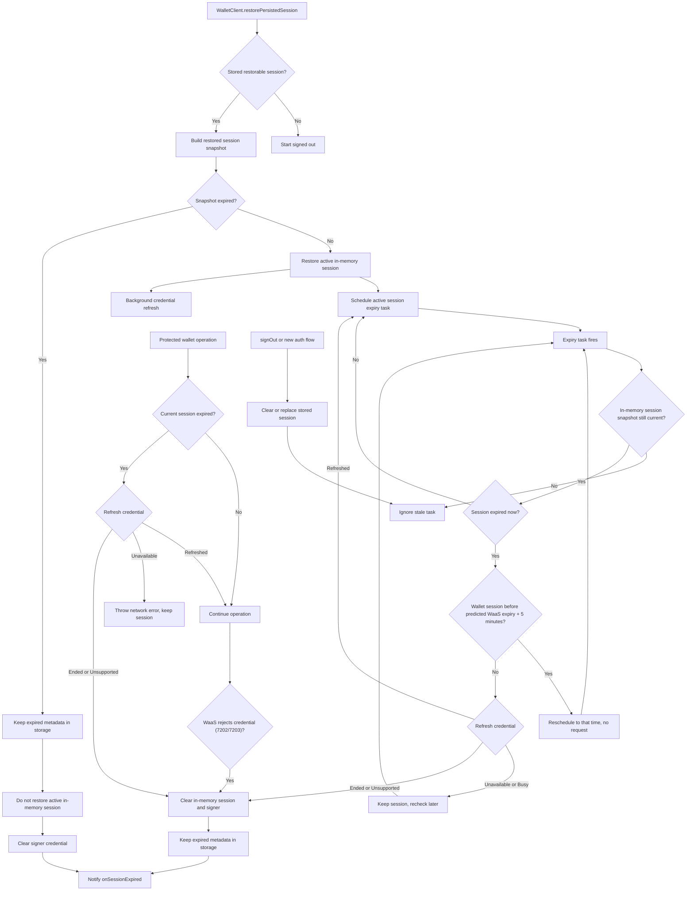

# Session Expiry Flow

This note documents the wallet session expiry flow for maintainers. Public API
behavior is covered in `docs/api.md`; this file focuses on how restored, active,
and stale expiry paths are coordinated.

## Behavior Contract

- `OMSWalletSession.expiresAt` (and `WalletCredential.expiresAt`) is the current
  expiry: WaaS slides it forward with use up to the requested lifetime (at most
  180 days), and the SDK refreshes it with WaaS `GetCredential`.
- A valid stored session is restored into memory, gets an expiry task, and is
  refreshed in the background. Restore itself never waits for or fails on the
  refresh.
- An expired stored session is discarded on restore without asking WaaS: it is
  not restored as active, but its metadata stays in storage so
  `onSessionExpired` can replay after process recreation.
- A session active in memory is checked with WaaS before it is treated as
  ended. It can expire from the scheduled task or from a protected wallet
  operation checking the session before use. Both refresh first: an extended
  expiry keeps the session, and only a session WaaS cannot extend expires.
- WaaS ends a session about 10 days after its last use (the idle window), or at
  the requested lifetime. Every request signed with the session's credential,
  including `GetCredential`, extends the idle window, so the expiry task does not
  read the credential of a session that looks idle until WaaS should have ended
  it. Without SDK activity, the SDK notices an ended idle session up to 5 minutes
  after WaaS ended it.
- A request signed with the session's credential that WaaS rejects with 7202
  `KeyNotFound` or 7203 `KeyExpired`, or a `GetCredential` that WaaS answers with
  7207 `Unauthorized` (the credential was revoked), ends the session like local
  expiry and fails with `OMS_SESSION_EXPIRED`. 7207 from any other call stays a
  request error. Unsigned `WaasPublic` calls never end the session.
- `signOut()` or a new auth flow clears or replaces stored session metadata,
  which cancels stale expired-session replay.

## Credential Refresh

`refreshSessionCredential` in `WalletClient` is the only refresh primitive.
Concurrent callers for the same session share one in-flight request, and a
result is applied only while the session revision that started it is current
(expiry updates do not bump the revision, so in-flight operations keep their
ownership). Outcomes:

| Outcome | Cause | Effect |
|---|---|---|
| Refreshed | `GetCredential` succeeded with a parseable `expiresAt` | The expiry replaces the session expiry (later or earlier), is saved to the session store, and reschedules the expiry task; the send time becomes the last expiry read |
| Ended | 7202 or 7203 (the transport ends the session), or 7207 (the refresh ends it) | The session ended and listeners were notified |
| Unsupported | `WebrpcBadRoute` (WaaS without `GetCredential`) | Remembered for the scope's lifetime; local expiry stays exact |
| Unavailable | Network or any other error, or an `expiresAt` that does not parse | Session unchanged |
| Busy | A signed session request was in flight when a background refresh tried to start, or the caller that started the shared refresh was cancelled | Skipped until the next trigger; a caller that needs an answer (a protected operation) starts a new refresh |

Triggers:

- Restore (`restorePersistedSession`): background refresh after a session is
  restored.
- Expiry task on a locally expired wallet session at local expiry `L`: let `C` be
  the last expiry read (sign-in, restore, or the send time of the last successful
  `GetCredential`) and `A` the send time of the last other request signed with
  the session's credential, whatever its outcome. If `A > C`, WaaS slid the
  expiry by about `A - C`, so the task reschedules to `L + (A - C) + 5 minutes`
  without a request; otherwise it reads the credential only once it is at least
  5 minutes past `L`, rescheduling to that time first. The task re-evaluates
  each time it fires. Then it refreshes: Refreshed reschedules; Ended or
  Unsupported expire as before; Unavailable or Busy keep the session and recheck
  after 60 seconds, doubling up to 15 minutes. A pending manual wallet
  selection, and a WaaS known to lack `GetCredential`, refresh at `L` without
  waiting.
- Protected operation on a locally expired session: awaits the refresh.
  Refreshed continues the operation; Ended or Unsupported throw
  `OMS_SESSION_EXPIRED`; Unavailable throws the network error and keeps the
  session.
- After a successful signed call (not `GetCredential`): background refresh when
  the last `GetCredential` sent, sign-in, or restore was at least 6 hours ago. A
  refresh skipped as Busy sends nothing, so it does not restart the 6 hours and
  the next successful signed call tries again.

WaaS requires strictly increasing nonces per credential, so a refresh never
overlaps another signed session request: background refreshes start only when
no signed request is in flight, the awaited refresh waits for in-flight requests
to finish, and signed requests started during a refresh wait for it before
signing. Other signed requests can still overlap each other, so one can reach
WaaS after a request with a later nonce; WaaS then rejects it in its credential
middleware, before running the method, with 7206 `PreconditionFailed` (HTTP 412),
and the signed transport signs it again with a fresh nonce and resends it, at
most 2 times.

## Flow

